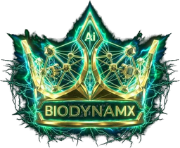
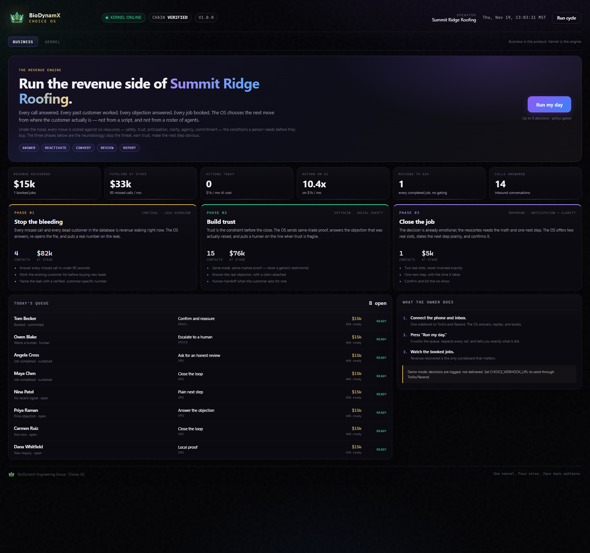

<p align="center"></p>

# BioDynamX Choice OS

[](https://github.com/BillyBull2020/bio2026/actions/workflows/ci.yml)
[](https://nodejs.org)
[](tests)
[](LICENSE)

**The AI revenue operating system for service businesses.** It answers the phone, works the
customers you already have, handles the objection, books the job, asks for the review, and
reports the money — with a decision engine modeled on the neurobiology of choice.

Not a chatbot. Not another CRM. Not fourteen agents. One kernel decides who to contact, what
to say, when to stop, and what it refuses to do. The agent is the smallest part of the system.

**What it runs:** capture → reactivate → convert → review → report. The owner connects the phone
and inbox, presses **Run my day**, and watches booked jobs. The OS shows the revenue at stake,
the three decision phases, and every action it took.

**New here?** [What Choice OS is for](docs/WHAT-IT-IS.md) · [Start here](START-HERE.md) · [Open the console](http://127.0.0.1:4177)

**Repository:** https://github.com/BillyBull2020/bio2026

**Open the console:** http://127.0.0.1:4177 · **First time?** Read [START-HERE.md](START-HERE.md)
or double-click **`Start-ChoiceOS.bat`**. Run `node src/cli.ts serve --host 0.0.0.0` to reach it
from your phone on the same Wi-Fi.

This repository is the complete, runnable operating system — not a slide deck and not
another prompt pack.

---

## Why this exists

The existing BioDynamX stack has **14 personas, four competing orchestrators, keyword
routing, in-memory "learnings", and no shared policy layer**. That is not an operating
system; it is a room full of salespeople with different scripts and no manager.

Three concrete failures follow from that shape:

1. **Routing by keyword is not routing by state.** "Price" does not mean the customer
   needs a closer. It means clarity or trust is the constraint, and the right move might be
   a one-page answer — not a handoff.
2. **Personas duplicate logic.** Every new agent re-implements memory, safety, tone and
   tool access. The 14th agent is 14 times the maintenance and zero times the leverage.
3. **No hard rails.** A language model can be argued out of a rule. Consent, quiet hours,
   claim substantiation and review gating have to live *outside* the model.

Choice OS replaces the roster with a kernel. Roles become permission bundles over shared
moves. Adding a "new agent" is a config change, not a new orchestration layer.

---

## Quickstart

Requires **Node 24+**. There are **zero runtime dependencies** — no install step, no build
step, no bundler.

```bash
node src/cli.ts demo        # seed a Denver roofing book, plan five decisions, print the messages
node src/cli.ts serve       # operator console at http://127.0.0.1:4177
node src/cli.ts simulate    # persona blasting vs. the kernel
node src/cli.ts tools       # list the capability layer
node --test "tests/**/*.test.ts"
```

Or with npm:

```bash
npm run demo
npm start
npm run simulate
npm test
```

Or Docker (persist the event log with a volume):

```bash
docker build -t biodynamx/choice-os .
docker run -p 4177:4177 -v choice-data:/app/data biodynamx/choice-os
```

The console opens on the **Business** view: revenue recovered, pipeline at stake, the three
decision phases, today's queue, and one **Run my day** button. The **Kernel** tab shows the
engine underneath — the six-resource field, the binding constraint, the drafted message, the
policy verdict and the alternatives it rejected.



New to the product? Read [What Choice OS is for](docs/WHAT-IT-IS.md) first.

---

## The model in one page

### Six resources (all 0–1, higher is better)

| Resource | What it answers | What moves it |
|---|---|---|
| **Safety** | Is this interaction safe? No pressure, no shame, an easy exit. | warm open, give control, human bridge |
| **Trust** | Are they credible and on my side? | local proof, objection answer, human bridge |
| **Anticipation** | Can I see a specific, believable better future? | future pace, real loss + control |
| **Clarity** | Do I know the next step, with low cognitive load? | reduce choices, plain next step, objection answer |
| **Agency** | Am I choosing this, or is it being done to me? | give control, two real options |
| **Commitment** | Have I already taken a small action? | micro-commitment, calendar hold, booking |

Readiness is a weighted, squashed combination. The **binding constraint** is the resource
that is both most lacking and most worth moving, after mutability and leverage. Momentum
(commitment) is deliberately gated: a frightened or confused person is not "one
micro-commitment away" from yes.

### Four roles, not fourteen

| Role | Job | Channels | Autonomy |
|---|---|---|---|
| **Concierge** | Answer, qualify, book, hand off | voice, SMS, web, email | full |
| **Reviver** | Reactivate the existing customer base | SMS, email, voice | full |
| **Advocate** | Confirm, review, close the loop | SMS, email | draft-only |
| **Analyst** | Produce audits and claims | web | human-required |

Personas survive as **voice skins** — Warm, Direct, Premium, Clinical. Jenny, Mark, Bella,
Titan and the rest become tone presets over the same kernel, not separate brains. See
[`docs/MIGRATION.md`](docs/MIGRATION.md) for the exact mapping of all 14.

### The decision loop

```
signal → update field → derive stage → enumerate legal moves → project readiness
      → score (gain · alignment · intent · stage − pressure) → policy check
      → render → policy check again → send or wait → log everything
```

The OS is allowed to **wait**. Doing nothing is a first-class decision with a score, a
reason and an event. Most systems cannot say "not now"; this one says it often.

---

## Policy rails (the part a model cannot override)

| Rail | Rule |
|---|---|
| Consent | Channel-specific, unexpired consent for marketing and review. |
| Quiet hours | No voice/SMS outside 8:00–21:00 in the contact's timezone. |
| Frequency | 1 per 24h, 3 per 7d, 8 per 30d. |
| Pressure budget | Every contact has 3.0 units. Pressure is spent, not free. |
| Claim trace | Currency, percentages and large numbers must trace to a verified claim. |
| Real urgency | Scarcity only from a real, future event. |
| Review integrity | Every completed job is asked; never only promoters; no star instructions. |
| No threat without a door | A named loss must be evidenced and paired with a control step. |
| AI disclosure | The first voice turn says plainly that the caller is an AI. |
| Vulnerable contact | A human takes over; automation never applies pressure. |
| Human approval | High-pressure moves and draft-only roles wait for a person. |

Rails run **before** generation (is this move legal?) and **after** generation (does the
copy smuggle in a number, guarantee or deadline?). Every verdict is stored with the action.

---

## What the simulation says

Synthetic cohort, 21 days, 6 seeds, 800 contacts. The baseline models three generic persona
touches over nine days; Choice OS uses the same move catalogue and the same field model,
plans every two days, and is allowed to do nothing. **This is a model, not field data.**

| Metric | Persona blasting | Choice OS | Delta |
|---|---:|---:|---:|
| Sends per contact | 2.92 | 1.97 | **−32.6%** |
| Reply rate | 6.8% | 7.9% | **+16.2%** |
| Booking rate | 2.6% | 2.8% | **+7.9%** |
| Opt-out rate | 5.1% | 2.9% | **−43.2%** |
| Revenue per 1,000 | $268,742 | $284,586 | **+5.9%** |

Across three cohorts the booking lift ranges **+7.9% to +19.4%**, revenue **+5.9% to
+18.4%**, sends **−32%**, opt-outs **−43%**. The direction is stable; the magnitude is an
assumption, not a promise. [`docs/RESULTS.md`](docs/RESULTS.md) prints every assumption and
the exact experiment that would falsify them.

---

## Repository map

```
bio2026/
├── src/
│   ├── neuro/        field.ts, signals.ts, moves.ts, types.ts
│   ├── kernel/       events.ts, store.ts, policy.ts, claims.ts, scheduler.ts, conductor.ts, seed.ts
│   ├── roles/        registry.ts (4 roles + 4 voice skins)
│   ├── render/       renderer.ts (deterministic copy, no model required)
│   ├── llm/          gateway.ts (rewrite-only model layer; optional)
│   ├── tools/        types.ts, registry.ts (capability layer, role-scoped)
│   ├── sim/          engine.ts (baseline vs kernel)
│   ├── api/          server.ts (JSON + SSE + static console)
│   └── cli.ts        demo, serve, simulate, seed, verify, reset
├── public/           index.html, styles.css, app.js
├── tests/            52 tests across field, policy, scheduler, kernel, sim, tools, API
├── docs/             architecture, science, migration, results, deployment
└── data/             events.jsonl (created on first run)
```

---

## Integration with the existing Next.js site

The kernel is plain TypeScript with no framework coupling. Copy `src/` into the Next.js
repo (or publish it as a workspace package) and wrap it:

```ts
// app/api/choice/plan/route.ts
import { KernelStore } from "@/choice/kernel/store";
import { Conductor } from "@/choice/kernel/conductor";
import { SEED_CLAIMS } from "@/choice/kernel/claims";
import { DEFAULT_SETTINGS } from "@/choice/kernel/policy";

const store = new KernelStore({ dataDir: process.env.CHOICE_DATA_DIR, claims: SEED_CLAIMS, settings: DEFAULT_SETTINGS });
const conductor = new Conductor(store, SEED_CLAIMS, DEFAULT_SETTINGS);

export async function POST(req: Request) {
  const { contactId } = await req.json();
  const result = conductor.dispatch(contactId, new Date().toISOString());
  return Response.json(result);
}
```

Then keep Twilio, Stripe, Supabase and Gemini Live as **tools** behind the kernel. They are
transport and persistence, not the brain. [`docs/DEPLOYMENT.md`](docs/DEPLOYMENT.md) has the
full cutover plan and the shadow-mode rollout.

---

## Tooling: one brain, many hands

Choice OS deliberately does **not** ship a second agent platform. Tools are capabilities
with a permission level and a role allowlist; they return data, never decisions.

| System | Verdict | Where it fits |
|---|---|---|
| **DeepSeek Harness** | Use | Build, test, audit, operate. Not a runtime dependency. |
| **Sellbird** | Use narrowly | Discovery and enrichment only. Import as zero-consent prospects; no sending, no AGPL code in the kernel. |
| **HyperFrames** | Use | Analyst proof videos. A rendered asset is a claim candidate, not a claim. |
| **nginx / Firebase / Cloudflare** | Use | Deployment and TLS. |
| **Hermes / OpenClaw, OpenMausBot, Mautic** | Do not use in the decision path | They are competing brains. At most isolated tool workers or chat surfaces. |

```bash
node src/cli.ts import-sellbird --file prospects.csv   # discovery, zero consent, kernel waits
node src/cli.ts proof-video --contact <id>             # queue a HyperFrames manifest
```

Full rationale and the integration contract: [`docs/TOOLING.md`](docs/TOOLING.md).

---

## Honest limitations

- **The simulation is synthetic.** It is a decision aid, not evidence. The pilot design in
  `docs/RESULTS.md` is the evidence.
- **No telephony or CRM connector ships here.** The kernel emits the action and the message;
  delivery is an adapter. A provider-neutral webhook (`CHOICE_WEBHOOK_URL`) is included so you
  can wire Twilio, Resend, n8n or Zapier without changing the kernel. This is deliberate: the
  rails are testable without a Twilio bill.
- **No LLM is required.** Copy is deterministic and claim-bound. A model can be added as a
  rewriter, but it cannot add numbers, deadlines or guarantees. That is a feature.
- **State is a JSONL event log + in-memory index.** Fine for a single tenant and tens of
  thousands of events; move to Postgres when you need concurrent writers and row-level
  security. One process should own the data directory. If the CLI importer writes while the
  server is running, call `POST /api/reload` (or restart) before reading.
- **The neuroscience is a design language, not a measurement.** We model resources and
  update them from evidence. We do not claim to read neurotransmitters. Read
  [`docs/THE-SCIENCE.md`](docs/THE-SCIENCE.md) for the constructs, the citations and the
  caveats.

---

## The one-sentence version

> **Stop hiring agents. Start operating a decision.**

BioDynamX Engineering Group · Denver, Colorado
