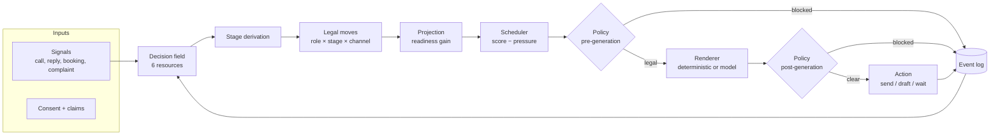

# Architecture

## The shape

Choice OS is a **decision kernel** with thin adapters. State is event-sourced; the field is
derived; the scheduler is pure; policy is a gate; rendering is deterministic by default.



Everything that changes state goes through `KernelStore.emit`. The reducer is pure, so
replaying `data/events.jsonl` from `GENESIS` reproduces contacts, fields, decisions,
actions, replies and bookings exactly.

---

## Modules

| Module | Responsibility | Key invariant |
|---|---|---|
| `neuro/types.ts` | Domain types, settings, moves, roles | No I/O |
| `neuro/field.ts` | Resources, readiness, decay, binding constraint, stage | Pure functions |
| `neuro/signals.ts` | Signal → resource deltas with confidence | Conservative, auditable |
| `neuro/moves.ts` | The 16-move catalogue | Every move has a guard |
| `kernel/events.ts` | Append-only hash-chained log | `hash = H(prevHash ‖ event)` |
| `kernel/store.ts` | Reducer, indexes, policy context | Replay is deterministic |
| `kernel/policy.ts` | Hard rails, content lint, claim/consent checks | A model cannot override |
| `kernel/claims.ts` | Claim registry, number extraction | Numbers trace or block |
| `kernel/scheduler.ts` | Enumerate, project, score, choose, explain | Wait is always allowed |
| `kernel/conductor.ts` | The only mutator: plan, dispatch, reply, tick | Every decision is logged |
| `roles/registry.ts` | Four roles, four voice skins | Roles grant moves, not logic |
| `render/renderer.ts` | Channel-aware copy from moves + facts | No invented numbers |
| `sim/engine.ts` | Baseline vs kernel simulation | Assumptions printed |
| `api/server.ts` | JSON, SSE, static console | No auth in this build |

---

## The field

Six resources, each 0–1:

```
safety, trust, anticipation, clarity, agency, commitment
```

**Updates** use diminishing returns:

```
x' = x + Δ · (1 − x) · 0.85      for Δ ≥ 0
x' = x + Δ · x · 0.85            for Δ < 0
```

This prevents a burst of messages from pumping trust to 1.0. **Decay** pulls each resource
toward its prior with a per-dimension half-life (12h to 90d). A lead that has been ignored
for a month is not still "hot".

**Readiness**:

```
weighted = Σ wᵢ · xᵢ
z        = (weighted − 0.46) · 8
P(yes)   = 1 / (1 + e^(−z))
```

**Binding constraint**:

```
scoreᵢ = (1 − xᵢ) · leverageᵢ · mutabilityᵢ · gatesᵢ
```

- `leverage`: commitment 1.15, trust 1.0, clarity 0.9, anticipation 0.85, safety 0.65, agency 0.6.
- `mutability`: derived from the moves that are legal *now*.
- `gates`: commitment is discounted to 30% when `min(trust, clarity, safety) < 0.45`;
  anticipation is discounted when trust < 0.30; agency when safety < 0.30.

The gates are the difference between a funnel and a model. A scared customer is not "one
micro-commitment away" from buying.

---

## Stages

```
dormant → open → trusted → framed → proven → committed → sustained
                 ↘ human        ↘ exited / paused
```

Stages are **derived at read time** from the last signal, the field and flags — not stored
as a mutable funnel position. A booking signal within 45 days means `committed`; a completed
job within 60 days means `sustained`; a complaint or human handoff within 30 days means
`human`. A recent non-terminal signal means `open`. This avoids the classic CRM failure where
a record is "Closed Won" forever.

---

## Scheduler

For each legal move:

```
Δreadiness = readiness(project(field, move)) − readiness(field)
alignment  = move.gain[binding]              # does it hit the actual constraint?
intent     = stage/signal bonus              # objection, not-now, vulnerable, booked…
score      = 80·Δreadiness + 15·alignment + intent + stageBonus
             + channelFit − pressure·(0.35 + 0.18·pressureSpent)
```

The highest score wins if it clears the **action floor** (1.40). Otherwise the decision is
`wait`, with the same alternatives, the same reason and an event. This is the most important
behaviour in the system: **attention is not free**, and a system that cannot wait will
always optimise for activity over outcomes.

### Intent bonuses (excerpt)

| Signal | Move | Bonus |
|---|---|---:|
| Price/time/trust objection | `objection_answer` | +12 |
| "Not now" | `close_loop` | +12 |
| High intent | `plain_next_step`, `calendar_hold` | +8 |
| Booked | `confirm` | +8 |
| Completed job | `review_request` | +6 |
| Complaint | `escalate_human` | +10 |
| Vulnerable | `escalate_human` | +20 |
| Human stage | non-human moves | filtered |

Intent is not a replacement for the field. It is a prior on *which* legal move is
stage-appropriate; policy still gates it.

---

## Policy pipeline

```
ActionInput ──► evaluatePolicy ──► { allowed, issues[], checkedAt }
```

Fifteen rule families, in order:

1. Opt-out (absolute except transactional).
2. Marketing consent by channel and purpose.
3. Review consent by channel.
4. Quiet hours in the contact's timezone.
5. Frequency caps (24h / 7d / 30d).
6. Pressure budget.
7. Vulnerable-contact escalation.
8. Claim presence, existence, expiry and segment match.
9. Same-segment proof.
10. Real deadline for slot holding.
11. Loss framing: safety floor + control language.
12. Manufactured urgency.
13. Review gating language / audience / do-not-ask.
14. AI disclosure on first voice turn.
15. Absolute-claim lint and untraceable numbers.

An issue has `severity: block | warn`. `allowed` is false only if a block exists. Warnings
(e.g. draft-only role, human approval) still return a message the console can show, but the
action is queued for a person rather than dispatched.

The **number check** is deliberately blunt: currency, percentages and integers ≥ 100 must
appear in an attached claim or in the contact's own facts (ticket, missed revenue, phone).
Years, clock times and small ordinals are structural and exempt. This is how "we recovered
$31,900 for a client" becomes a claim, not a sentence a model can improvise.

---

## Event sourcing

```ts
interface KernelEvent {
  seq: number;
  id: string;
  at: string;
  type: string;
  contactId?: string;
  actor: string;
  payload: Record<string, unknown>;
  prevHash: string;
  hash: string;
}
```

Event types: `tenant.configured`, `contact.created`, `signal.recorded`, `contact.updated`,
`consent.changed`, `decision.made`, `action.sent`, `action.blocked`, `reply.received`,
`booking.created`, `booking.updated`, `human.handoff`, `contact.opted_out`, `claim.added`.

Why hash-chain:

- **Tamper evidence.** Change one payload and every subsequent hash fails.
- **Audit cost is near zero.** A client can be shown the exact decision trail.
- **Replay is the backup.** No independent snapshot can drift from the log.

`npm run verify` prints the chain state and the broken sequence number, if any.

---

## The conductor

`Conductor` is the only class that mutates state:

- `planFor(contactId, now)` — pure planning, no writes.
- `dispatch(contactId, now)` — plan, log the decision, policy-check, log the action or block.
- `handleReply(contactId, text, now)` — classify, log reply + signal, opt out on STOP, book
  on a booking intent, then re-plan on the new state.
- `tick(now, limit)` — rank the portfolio by readiness × ticket + inbound recency, dispatch
  at most `limit` actions.

The separation matters: planning is cheap and side-effect free; dispatch is explicit and
auditable. The simulator and the API both use the same planner.

---

## Roles as permission bundles

```ts
interface RoleDefinition {
  id: string;
  purpose: Purpose[];
  channels: Channel[];
  moves: MoveId[];
  voiceSkin: VoiceSkinId;
  autonomy: "full" | "draft_only" | "human_required";
}
```

A role cannot invent a move. It can only use the shared catalogue. A voice skin changes
greeting, sign-off, warmth, brevity and formality — not strategy. This is why adding a
persona is a one-line config change, and why removing one does not delete a memory store.

---

## Failure modes and mitigations

| Failure | Mitigation |
|---|---|
| Model invents a number | Claim trace blocks untraceable currency/percent/large numbers. |
| Model manufactures urgency | Real-deadline rule; `calendar_hold` requires an actual slot. |
| Agent pushes a grieving/vulnerable person | Vulnerable flag forces human; pressure > 0.05 is blocked. |
| Review gating | Audience must be `all_completed`; gating phrases blocked. |
| Opt-out missed by a channel | Opt-out is global; all non-transactional contact blocked. |
| Stale lead treated as hot | Per-dimension decay toward prior. |
| Scheduler over-contacts | Pressure budget + frequency caps + wait floor. |
| State divergence after crash | Replay from `events.jsonl`; `verify` detects corruption. |
| Duplicate agent logic | One move catalogue, one renderer, one policy engine. |

---

## Scaling path

This build is intentionally single-tenant and in-process. The next steps, in order:

1. **Postgres**: `events(seq bigserial, ...)` + a materialised contact view. Keep the
   reducer; swap the store adapter. Row-level security by tenant.
2. **Queue**: dispatch actions to a worker (Twilio/Resend) with idempotency keys; the kernel
   never blocks on a provider.
3. **Tool adapters**: calendar, CRM, telephony, review platform. Each adapter returns an
   event; the kernel never calls a provider directly.
4. **Model layer**: a rewrite-only LLM behind the policy gate. The model receives the
   move, the facts and the guard; it returns copy; the policy runs again.
5. **Multi-tenant**: `tenant_id` on every event; per-tenant claims and settings; separate
   encryption keys.

The invariants to preserve: **the log is the source of truth**, **the scheduler is pure**,
**policy is outside the model**, and **wait is always legal**.
